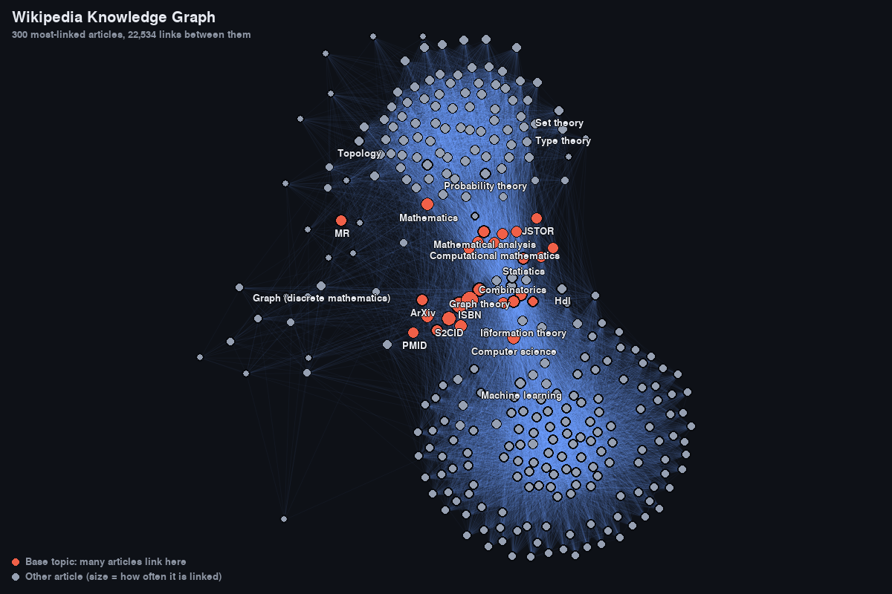

[](https://github.com/Raisa4/wiki_graph/actions/workflows/test.yml)

# Wikipedia Knowledge Graph

Crawls Wikipedia's link structure into SQLite, ranks articles by how often other articles link to them, and draws the most central ones as an interactive force-directed graph. The layout algorithm is written from scratch, with no graph libraries.



*The 300 most-linked articles from a 500-page crawl starting at "Graph theory". The citation hubs and core topics sit in the middle. The two dense clusters are the members of Wikipedia's mathematics and computer-science navigation boxes, since every page that includes a navbox links to all of its entries. Regenerate with `python main.py analyze --top 300 --width 1200 --height 800 --screenshot docs/screenshot.png`.*

- **Node size** grows with how many crawled articles link to the node.
- **Red nodes:** *base topics*, which many crawled articles link to.
- **Blue nodes:** *niche topics*, which rarely get linked to but link out to many articles. Because they're rarely linked, they almost never make a top-N view.
- **Gray nodes:** everything else.
- **Edges** add up in brightness, so heavily linked regions glow.

Hover over any node to see its title, heat and outgoing link count. Press Esc to close.

## How it works

```
scraper.py        BFS crawl via the MediaWiki API  ──►  wiki_graph.db (articles, edges)
graph_metrics.py  in/out degree, normalised "heat" score, node categories
physics.py        Fruchterman–Reingold force-directed layout
renderer.py       Pygame viewer with hover labels
main.py           command-line entry point
```

## Running it

Requires Python 3.10+.

```bash
pip install -r requirements.txt

# Optional: Wikimedia asks API clients to identify themselves
export WIKI_GRAPH_CONTACT="you@example.com"

# 1. Crawl. Safe to stop and re-run: it resumes where it left off.
python main.py crawl --seed "Graph theory" --max-pages 500

# 2. Rank, lay out and view the top 300 articles
python main.py analyze --top 300
```

Add `-v` before the subcommand for debug-level progress logs, and `--help` on any command for all options.

Run the tests with:

```bash
pytest
```

## Design decisions

**Threads fetch, the main thread writes.** A `ThreadPoolExecutor` fetches a batch of pages in parallel, since the work is network-bound. All SQLite reads and writes stay on the main thread, because a SQLite connection shouldn't be shared across threads. This avoids locks entirely.

**The database is the crawl state.** The `articles` table works as the BFS "seen" set: a link is queued only if `INSERT OR IGNORE` actually inserted a new row. Each page is marked `visited` only after its links have been saved. On startup, every `visited = 0` row is loaded back into the queue, so an interrupted crawl resumes instead of starting over. A page that fails to fetch is never marked visited, so a later run retries it.

**Being a polite API client.** Every request has a 10 s timeout and up to 3 attempts. On HTTP 429, the scraper sleeps for the server's `Retry-After` value before retrying. Batches are spaced 0.5 s apart. Large articles are fetched in full by following `plcontinue`. `plnamespace=0` keeps only real articles, so `Talk:`, `Category:` and `Template:` pages don't skew the rankings.

**A from-scratch layout.** `physics.py` implements Fruchterman–Reingold:
- every pair of nodes repels with force k²/d,
- every edge pulls like a spring with force d²/k, divided by √degree of the node being pulled. The top 300 articles share ~22,000 edges, and without this damping each node is pulled by ~150 springs at once and the layout collapses into a blob,
- each step's movement is capped by a "temperature" that cools by 10% per iteration, so the graph settles instead of oscillating.

## Limitations

- **O(n²) repulsion.** Every layout iteration compares every pair of nodes, which is why only the top 300 nodes are drawn. A Barnes–Hut quadtree would bring this down to O(n log n).
- **Heat depends on where the crawl started.** In-degree only counts links from pages that have been crawled, so articles near the seed score higher than their global importance warrants.
- **Single-threaded writes.** Parsing is cheap compared with the network, but a very large crawl would eventually be limited by SQLite commits on the main thread.
- **Citation templates dominate the ranking.** Reference templates make nearly every article link to pages like `ISBN (identifier)` and `Doi (identifier)`, so these come out as the "hottest" nodes. Filtering them out is a possible next step.
- **Redirects.** Links are stored under their linked title, so `USA` and `United States` can appear as separate nodes.
